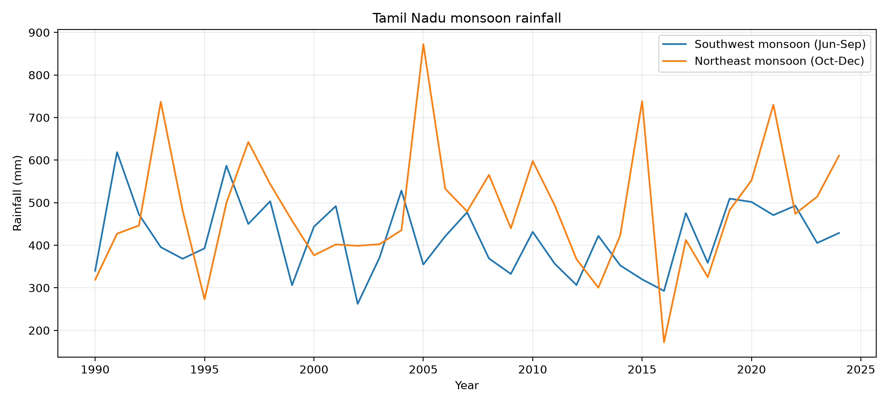
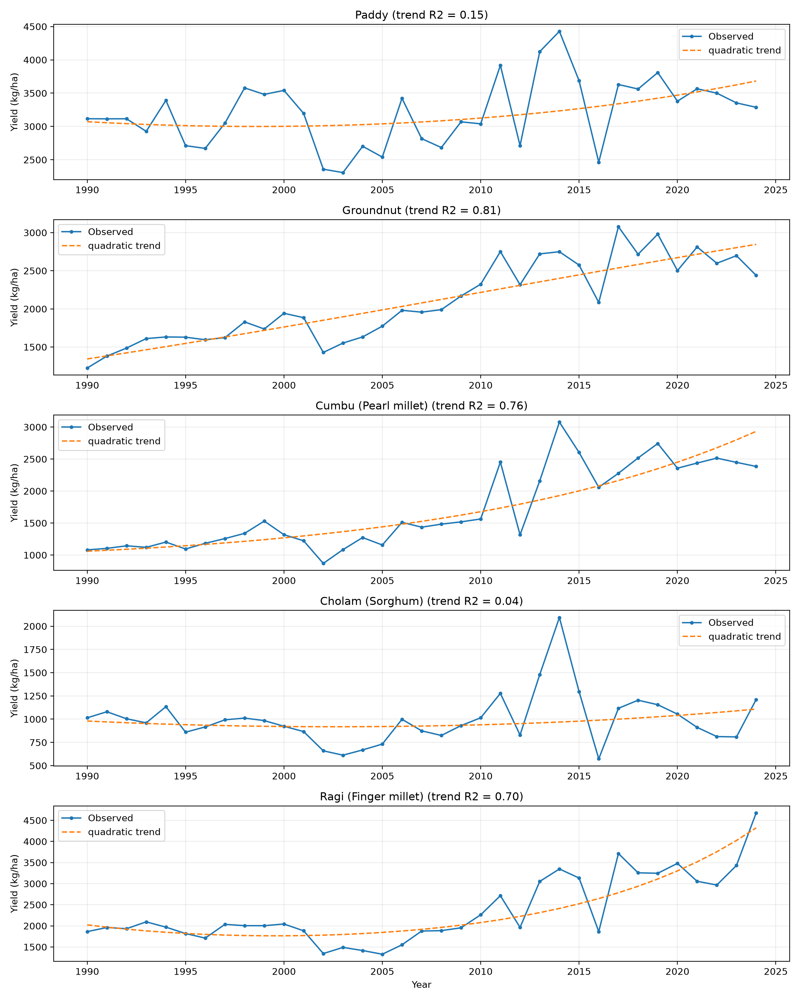
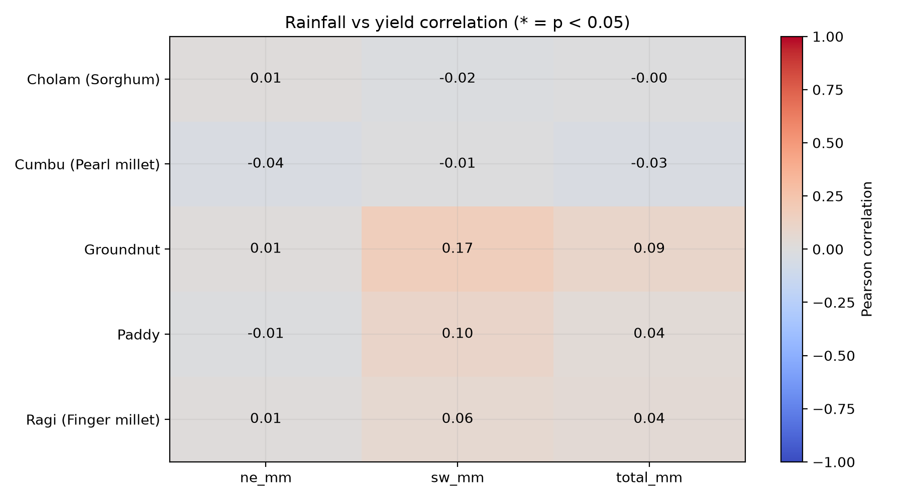
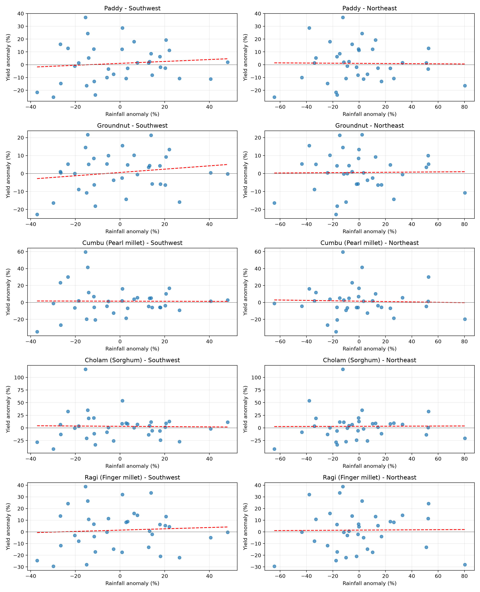
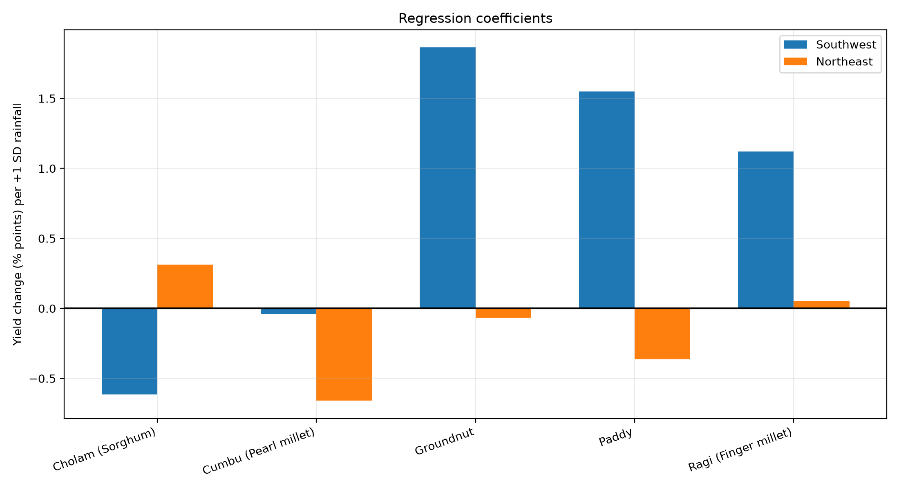
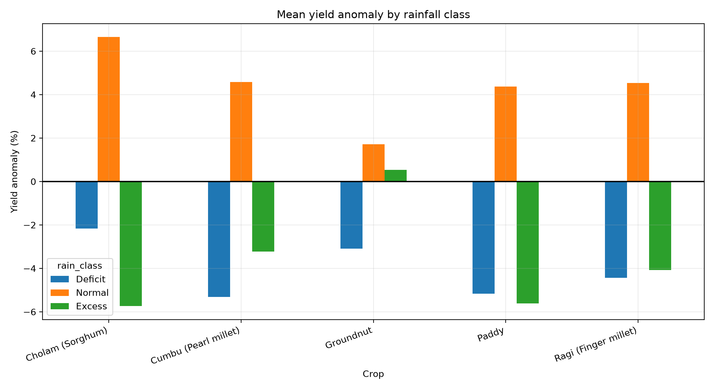
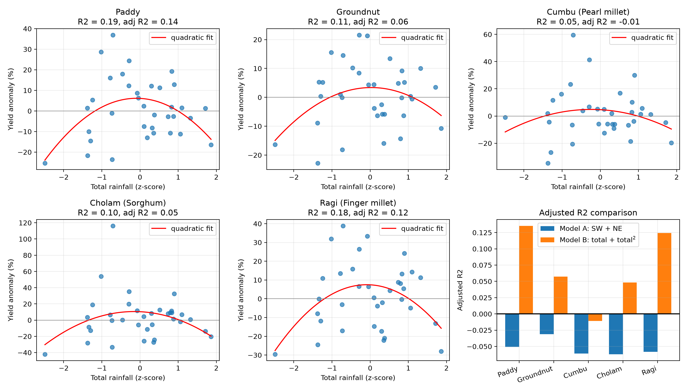

#Rainfall and Crop Yield Statistical Analysis

## Project Overview

This project presents a Python-based statistical analysis of Tamil Nadu monsoon rainfall and crop yield data for the period 1990 to 2024.

The project studies whether year-to-year variation in the Southwest (Jun-Sep) and Northeast (Oct-Dec) monsoon rainfall explains year-to-year variation in the yield of five major crops: Paddy, Groundnut, Cumbu (Pearl millet), Cholam (Sorghum) and Ragi (Finger millet). The analysis uses correlation, linear and quadratic regression, and rainfall-class comparison, and presents the findings through visualizations.

## Objectives

- Analyze rainfall and crop yield data from 1990-2024.
- Remove the long-term yield trend to isolate the effect of rainfall.
- Measure the correlation between rainfall and crop yield.
- Fit a linear regression of yield anomaly on SW and NE rainfall (Model A).
- Fit a quadratic regression of yield anomaly on total rainfall to test for a hump-shaped response (Model B).
- Compare crop yield in Deficit, Normal and Excess rainfall years.
- Create visualizations for better understanding of the results.

## Dataset

All input datasets are stored in the `Data` folder.

### Dataset Files

- `tamilnadu_crop_yield_1965_2025.csv` - crop area, production and yield, 1965-66 to 2024-25, 19 crops (also provided as `.xlsx`)
- `rainfall_1990_2024_e238625a.csv` - SW and NE monsoon rainfall (mm) per year, 1990-2024

### Rainfall data

Daily rainfall (NASA POWER, `PRECTOTCORR`) was downloaded for eight Tamil Nadu locations (Chennai, Vellore, Salem, Coimbatore, Thanjavur, Trichy, Madurai, Tirunelveli) and averaged. It was then summed into SW (Jun-Sep) and NE (Oct-Dec) seasonal totals. The script saves this as `rainfall_1990_2024_e238625a.csv` and reuses it on later runs.

### Columns in `merged_data.csv`

`merged_data.csv` is created by the script in the `Results` folder, with one row per crop-year (175 rows).

| Column | Meaning |
|---|---|
| `Crop`, `year` | Crop name and year |
| `yield` | Observed yield (kg/ha), taken from the `Yield recomputed` column of the crop file |
| `sw_mm`, `ne_mm`, `total_mm` | SW, NE and combined rainfall (mm) |
| `*_anom` | Rainfall anomaly, % deviation from the 1990-2024 mean |
| `*_z` | Rainfall standardised to z-scores |
| `yield_trend` | Fitted quadratic time trend of yield |
| `yield_anom` | Yield anomaly, % deviation from the trend |
| `rain_class` | `Deficit` (total z < -1), `Normal`, or `Excess` (total z > +1) |

## Data Visualization

The project contains plots representing different aspects of the data:

### 1. Monsoon Rainfall Trends



### 2. Crop Yield Trends



### 3. Correlation Heatmap



### 4. Rainfall vs Yield Scatter Plots



### 5. Regression Coefficients (Model A)



### 6. Yield Anomaly by Rainfall Class



### 7. Quadratic Model (Model B)



## Methodology

The project studies the effect of rainfall on yield after removing the long-term trend.

The analysis performs the following steps:

1. Read the yield data and use the recomputed yield (production / area), with the starting year of each crop year (1990-91 becomes 1990).
2. Combine SW and NE rainfall per year and calculate total rainfall (SW + NE).
3. Fit a quadratic time trend to the log of each crop's yield.
4. Calculate the yield anomaly as the percentage deviation of observed yield from this trend.
5. Calculate rainfall anomalies (% of mean) and standardised z-scores.
6. Calculate Pearson and Spearman correlations between rainfall anomaly and yield anomaly. P-values come from a permutation test (2,000 permutations, fixed seed 42).
7. Fit **Model A**, a linear regression of yield anomaly on standardised SW and NE rainfall.
8. Fit **Model B**, a quadratic regression of yield anomaly on standardised total rainfall and its square.
9. Classify years as Deficit, Normal or Excess (total rainfall z-score below -1, between -1 and +1, above +1) and calculate the mean yield anomaly of each class.

The two regression models are:

```
Model A:  yield_anomaly = a + b_SW × SW_z + b_NE × NE_z
Model B:  yield_anomaly = a + b1 × total_z + b2 × total_z²
```

In Model B, a negative `b2` means a hump: yield is highest near normal rainfall and lower in both dry and very wet years. Model B is also checked with leave-one-out Q², which shows how well it predicts years it has not seen.

## Results

Rainfall totals show no statistically significant linear relationship with crop yield (Model A explains almost nothing). Allowing a curved response (Model B) raises R² to 5-19%, with a hump peaking near normal rainfall for every crop. The curve is statistically significant for paddy and ragi only.

### Result Files

The detailed numerical results are available in the `Results` folder, and all plots are in the `Plots` folder.

- `correlations.csv` - Pearson and Spearman correlations with permutation p-values.
- `regression_results.csv` - Model A: R², adjusted R², coefficients and p-values.
- `regression_results_quadratic.csv` - Model B: R², adjusted R², p-values, curve shape, turning point and leave-one-out Q².
- `rainfall_class_analysis.csv` - Mean yield anomaly (%) in Deficit, Normal and Excess years.
- `merged_data.csv` - The combined analysis dataset.

### Correlation Results

Pearson correlation of yield anomaly with rainfall anomaly (35 years each; none significant at 5%).

| Crop | SW | NE | Total |
|---|---:|---:|---:|
| Paddy | 0.10 | -0.01 | 0.04 |
| Groundnut | 0.17 | 0.01 | 0.09 |
| Cumbu (Pearl millet) | -0.01 | -0.04 | -0.03 |
| Cholam (Sorghum) | -0.02 | 0.01 | -0.00 |
| Ragi (Finger millet) | 0.06 | 0.01 | 0.04 |

### Yield Trend

Quadratic time-trend R²: Groundnut 0.81, Cumbu 0.76, Ragi 0.70, Paddy 0.15, Cholam 0.04.

### Model A: Linear Regression (SW + NE)

| Crop | R² | Adjusted R² | SW Coefficient | NE Coefficient |
|---|---:|---:|---:|---:|
| Paddy | 0.011 | -0.051 | 1.549 | -0.364 |
| Groundnut | 0.029 | -0.031 | 1.865 | -0.067 |
| Cumbu (Pearl millet) | 0.001 | -0.061 | -0.040 | -0.660 |
| Cholam (Sorghum) | 0.001 | -0.062 | -0.616 | 0.314 |
| Ragi (Finger millet) | 0.004 | -0.058 | 1.122 | 0.053 |

No coefficient is significant (all p > 0.3), and adjusted R² is negative for every crop.

### Model B: Quadratic Regression (total rainfall + total rainfall²)

| Crop | R² | Adjusted R² | Model p-value | Quadratic term p-value | Leave-one-out Q² |
|---|---:|---:|---:|---:|---:|
| Paddy | 0.186 | 0.135 | 0.029 | 0.010 | 0.072 |
| Ragi (Finger millet) | 0.176 | 0.124 | 0.046 | 0.012 | 0.060 |
| Groundnut | 0.113 | 0.057 | 0.150 | 0.056 | -0.018 |
| Cholam (Sorghum) | 0.104 | 0.048 | 0.163 | 0.071 | -0.030 |
| Cumbu (Pearl millet) | 0.049 | -0.011 | 0.444 | 0.203 | -0.141 |

All five crops show a hump (negative quadratic term) peaking near normal rainfall. Only paddy and ragi are statistically significant at 5%, and only they predict better than the average in the leave-one-out test. Cumbu stays weak.

### Rainfall Class Analysis

Mean yield anomaly (%) by rainfall class.

| Crop | Deficit | Normal | Excess |
|---|---:|---:|---:|
| Paddy | -5.16 | 4.36 | -5.61 |
| Groundnut | -3.09 | 1.71 | 0.53 |
| Cumbu (Pearl millet) | -5.32 | 4.57 | -3.23 |
| Cholam (Sorghum) | -2.17 | 6.65 | -5.74 |
| Ragi (Finger millet) | -4.43 | 4.53 | -4.08 |

## Limitations

- Only 35 years per crop, so statistical power is low.
- State-level averages hide regional differences (irrigated delta vs rainfed areas).
- Only seasonal rainfall totals are used; timing and distribution within the season are not captured.
- Irrigation, area, inputs and prices are not modelled.
- Even the best model (Model B) explains at most about 19% of yield variation, so most variation comes from other factors.
- The class comparison is descriptive and has no significance test.
- Several tests are run (15 correlations, 10 regression terms), so a few could look significant by chance.

## How to Run

1. Put `tamilnadu_crop_yield_1965_2025.csv` and `rainfall_1990_2024_e238625a.csv` in the `Data` folder.
2. Run `python "Rain analytics.py"`.
3. On the first run the script creates a private environment and installs pandas, numpy and matplotlib automatically.
4. If the rainfall file is missing, the script downloads it from NASA POWER (internet needed, about a minute).
5. Result tables are saved in the `Results` folder and plots in the `Plots` folder.

## Technologies Used

- Python
- pandas, NumPy, Matplotlib
- NASA POWER API (rainfall data)
- Microsoft Excel
- VS Code
- Git
- GitHub

## Project Structure

```text
Rainfall-Crop-Yield-Analysis/
│
├── Data/
│   ├── tamilnadu_crop_yield_1965_2025.csv
│   ├── tamilnadu_crop_yield_1965_2025.xlsx
│   └── rainfall_1990_2024_e238625a.csv
│
├── Plots/
│   ├── 01_rainfall_trends.png
│   ├── 02_crop_yield_trends.png
│   ├── 03_correlation_heatmap.png
│   ├── 04_scatter_plots.png
│   ├── 05_regression.png
│   ├── 06_rainfall_classes.png
│   └── 07_quadratic_model.png
│
├── Results/
│   ├── merged_data.csv
│   ├── correlations.csv
│   ├── regression_results.csv
│   ├── regression_results_quadratic.csv
│   └── rainfall_class_analysis.csv
│
├── Rain analytics.py
├── .gitignore
└── README.md
```
